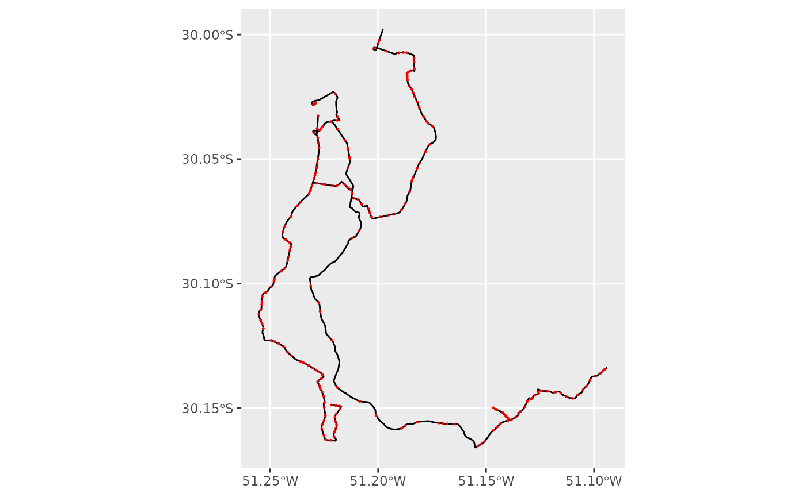
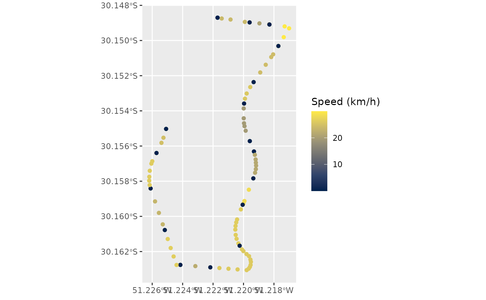
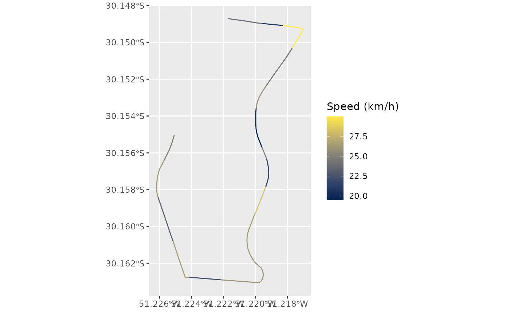

# gtfs2gps: Converting GTFS data to GPS-like format

Abstract

Package `gtfs2gps` converts public transport GTFS data to GPS-like
records using `data.table`. It also has functions to post-process these
records, for example converting them to simple feature format.

## Introduction

Package `gtfs2gps` allows users to convert public transport GTFS data
into a single `data.table` format with GPS-like records, tracking the
space-time position of individual vehicles at high spatial and temporal
resolutions. This GPS-like data format is quite convenient as it can be
easily used in various applications for running transport simulations,
scenario analyses, data visualizations etc.

To start using the package, you can install it from CRAN:

``` r

install.packages("gtfs2gps")
```

## Loading data

After loading the package, you can read a GTFS feed using
[`read_gtfs()`](https://ipea.github.io/gtfs2gps/dev/reference/read_gtfs.md).
This function gets a zipped GTFS file and returns a list of `data.table`
objects (a `dt_gtfs` object from {gtfstools}). To demonstrate the
package, we will use a small sample of the GTFS from Porto Alegre,
Brazil.

``` r

library("gtfs2gps")

# path to gtfs file
gtfs_file <- system.file("extdata/poa.zip", package = "gtfs2gps")

# read gtfs to memory
poa <- gtfs2gps::read_gtfs(gtfs_file)

names(poa)
#> [1] "agency"     "calendar"   "routes"     "shapes"     "stop_times"
#> [6] "stops"      "trips"
```

The returning list contains the tables from the GTFS file indexed
according to their file names.
[`read_gtfs()`](https://ipea.github.io/gtfs2gps/dev/reference/read_gtfs.md)
checks that the tables required by {gtfs2gps} are present and not empty:

- `routes.txt`
- `shapes.txt`
- `stop_times.txt`
- `stops.txt`
- `trips.txt`

If the feed has a `frequencies.txt` file, it is used as well.

If you’d like to visualize how the transport network looks like, you can
use a few convenient functions from
[{gtfstools}](https://github.com/ipea/gtfstools/), our sister package.

``` r

library(ggplot2)

# get spatial geometries of GTFS
shapes_sf <- gtfstools::get_shapes_geometry(poa)
stops_sf <- gtfstools::get_stops_geometry(poa)

ggplot() +
  geom_sf(data = shapes_sf) +
  geom_sf(data = stops_sf, color = "red", size = .2)
```



Sometimes, GTFS feeds come with internal inconsistencies, for example
with trips going too fast, or not accounting for dwell time, etc. We
highly recommend that you use {gtfstools} functions to profile, clean
and edit your GTFS data before running {gtfs2gps} on it. In the example
below, we run
[`gtfstools::fix_gtfs()`](https://ipea.github.io/gtfstools/reference/fix_gtfs.html),
a simple and convenient function to fix a few of these issues. Here, we
use this function to try to cap the max speed between stops at 25 km/h
and to set a min dwell time of 30 secs, and the function recalculates
the stop times of the feed. Note that `fix_gtfs()` works on the stop
times, so some segments of the output of
[`gtfs2gps()`](https://ipea.github.io/gtfs2gps/dev/reference/gtfs2gps.md)
can still be faster than 25 km/h.

``` r

# quick fix
poa_fixed <- gtfstools::fix_gtfs(
  gtfs = poa,
  max_speed = 25,
  min_dwell_time = 30
  )
```

## Converting to GPS-like format

To convert GTFS to GPS-like format, use
[`gtfs2gps()`](https://ipea.github.io/gtfs2gps/dev/reference/gtfs2gps.md).
This is the core function of the package. It takes a GTFS zipped file or
a GTFS object as an input and returns a `data.table` where each row
represents a ‘GPS-like’ data point for every trip in the GTFS file. In
summary, this function interpolates the space-time position of each
vehicle in each trip considering the network distance and average speed
between stops. The function samples the timestamp of each vehicle every
$`100m`$ by default, but the user can set a different value in the
`spatial_resolution` argument. See the example below.

``` r

poa_gps <- gtfs2gps(
  gtfs_data = poa_fixed,
  spatial_resolution = 100
  )
```

### Tip 1: Parallelization

You can use the argument `ncores` to set how many threads the function
uses to parallelize operations. The default is 2, `ncores = 1` runs
sequentially, and `ncores = Inf` uses all the threads available, as
given by
[`data.table::getDTthreads()`](https://rdrr.io/pkg/data.table/man/openmp-utils.html).
Using more threads can reduce computation time in large GTFS feeds, and
the result is the same for any number of threads.

### Tip 2: Coping with RAM memory limits

In some really large GTFS feeds, the output of
[`gtfs2gps()`](https://ipea.github.io/gtfs2gps/dev/reference/gtfs2gps.md)
can sum to dozens of millions of rows. To help with this, you can pass
to the argument `filepath` the path to a local directory, and the
function will save the output of each shape to a separate file in this
directory (`.txt`, or `.rds` with `compress = TRUE`) without loading
them to your RAM.

## Visualizing gtfs2gps output

The output of
[`gtfs2gps()`](https://ipea.github.io/gtfs2gps/dev/reference/gtfs2gps.md)
looks like a traditional GPS data set: each row is the timestamp and
location of a vehicle on a trip scheduled in the GTFS. The output
includes a few columns indicating the speed, distance travelled and
whether a given point is at a transit stop.

``` r

head(poa_gps)
#>    shape_id     trip_id route_type    id timestamp shape_pt_lon shape_pt_lat
#>      <char>      <char>      <int> <int>   <ITime>        <num>        <num>
#> 1:    176-1 176-1@1#602          3     1  06:02:00    -51.22170    -30.14870
#> 2:    176-1 176-1@1#602          3     2  06:02:00    -51.22170    -30.14870
#> 3:    176-1 176-1@1#602          3     3  06:02:04    -51.22143    -30.14875
#> 4:    176-1 176-1@1#602          3     4  06:02:13    -51.22085    -30.14881
#> 5:    176-1 176-1@1#602          3     5  06:02:26    -51.21991    -30.14894
#> 6:    176-1 176-1@1#602          3     6  06:02:31    -51.21960    -30.14897
#>    stop_id stop_sequence             speed       dist     cumdist    cumtime
#>     <char>         <int>           <units>    <units>     <units>    <units>
#> 1:      59             1 1.0000e-12 [km/h]  0.000 [m]   0.000 [m]  0.000 [s]
#> 2:      59             1 1.0000e-12 [km/h]  0.000 [m]   0.000 [m]  0.000 [s]
#> 3:    <NA>            NA 2.3792e+01 [km/h] 26.649 [m]  26.649 [m]  4.032 [s]
#> 4:    <NA>            NA 2.3792e+01 [km/h] 56.249 [m]  82.898 [m] 12.544 [s]
#> 5:    <NA>            NA 2.3792e+01 [km/h] 91.527 [m] 174.425 [m] 26.393 [s]
#> 6:    5776             2 2.3792e+01 [km/h] 30.448 [m] 204.873 [m] 31.000 [s]
#>    trip_number
#>          <int>
#> 1:           1
#> 2:           1
#> 3:           1
#> 4:           1
#> 5:           1
#> 6:           1
```

To help with the spatial visualization of the output, you can use two
support functions to convert the GPS-like data into `simple feature`
points or linestrings. Let’s see an example with the first 100 data
points of the sample data we processed, coloured by speed.

``` r

poa_gps100 <- poa_gps[1:100, ]

# points
points_sf <- gtfs2gps::gps_as_sfpoints(poa_gps100)

ggplot() +
  geom_sf(data = points_sf, aes(color = as.numeric(speed))) +
  scale_color_viridis_c(option = "cividis") +
  labs(color = "Speed (km/h)")
```



``` r

# linestring
linestring_sf <- gtfs2gps::gps_as_sflinestring(poa_gps100)

ggplot() +
  geom_sf(data = linestring_sf, aes(color = as.numeric(speed))) +
  scale_color_viridis_c(option = "cividis") +
  labs(color = "Speed (km/h)")
```



Note:
[`gps_as_sflinestring()`](https://ipea.github.io/gtfs2gps/dev/reference/gps_as_sflinestring.md)
creates one linestring for each segment between two consecutive stops of
a trip, assuming a constant average speed between them. The
`spatial_resolution` argument of
[`gtfs2gps()`](https://ipea.github.io/gtfs2gps/dev/reference/gtfs2gps.md)
controls how far apart the points are within each segment, not the
length of the segments.

## Methodological note

For a given trip, the function `gtfs2gps` calculates the average speed
between each pair of consecutive stops given by the ratio between
cumulative network distance `S` and departure time `t` for a consecutive
pair of valid stop_ids (`i`),


Each stop appears as two data points in the output: the first has the
time the vehicle arrives at the stop (`arrival_time` in
`stop_times.txt`), and the second the time it departs
(`departure_time`), with the vehicle stationary between them. The
`speed`, `dist` and `cumtime` columns are computed from the difference
between each row and the previous row of the same trip, and `cumdist`
and `cumtime` start at zero at the first stop with a departure time (at
its arrival, when it has one).

A shape often begins before the first stop of its trips or ends after
the last one (in the poa feed, about half of the trips start before
their first stop). Those points have no time to be interpolated from, so
each trip only runs from its first to its last stop with a departure
time: the points of the shape outside them are not returned. Unrealistic
speeds are best fixed in the GTFS before converting it, with
[`gtfstools::set_max_speed()`](https://ipea.github.io/gtfstools/reference/set_max_speed.html)
and
[`gtfstools::set_min_speed()`](https://ipea.github.io/gtfstools/reference/set_min_speed.html).

## Final remarks

If you have any suggestions or want to report an error, please visit the
GitHub page of the package [here](https://github.com/ipea/gtfs2gps).
